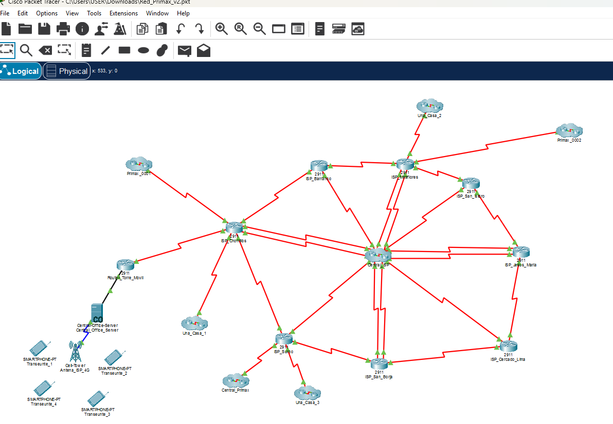
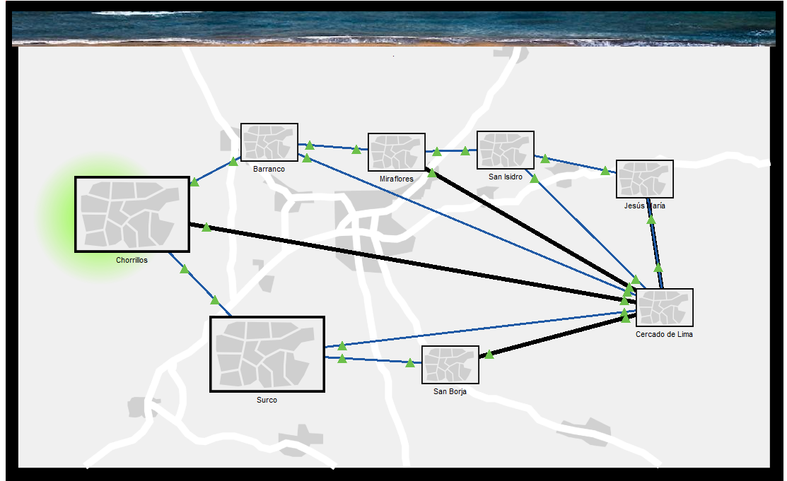
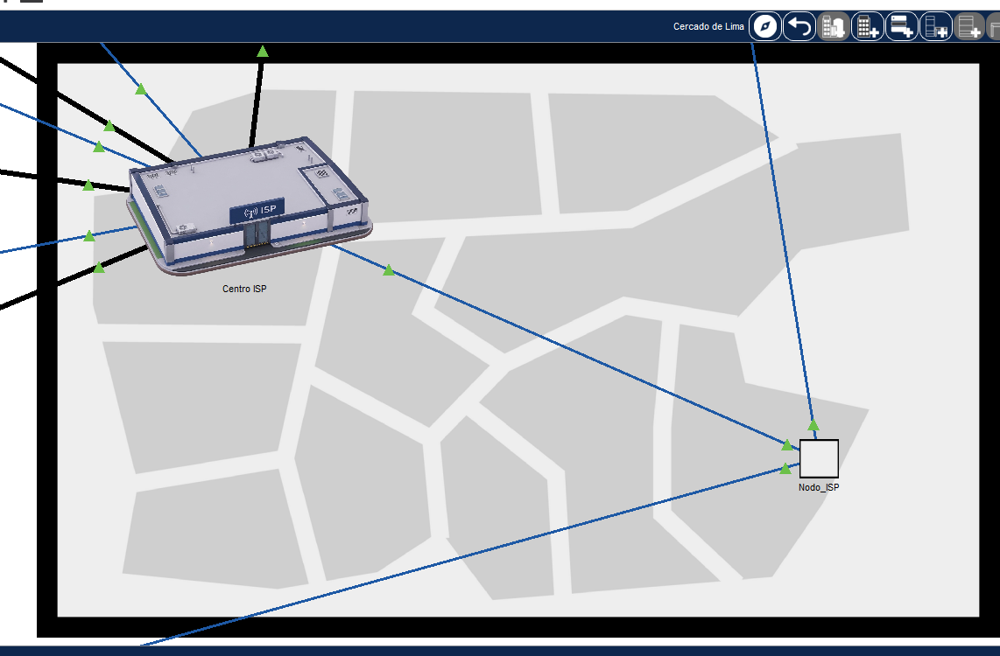
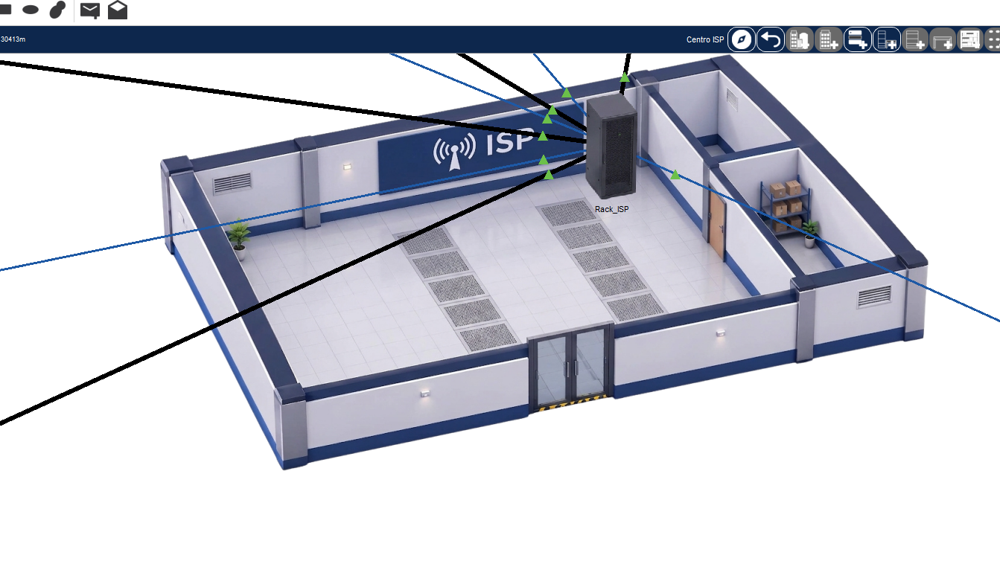
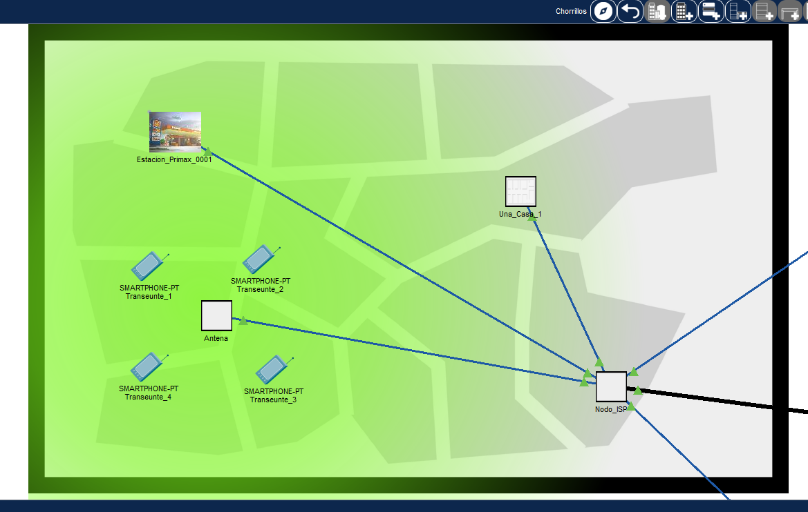
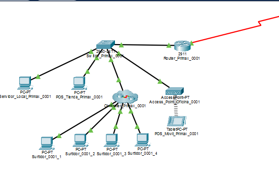
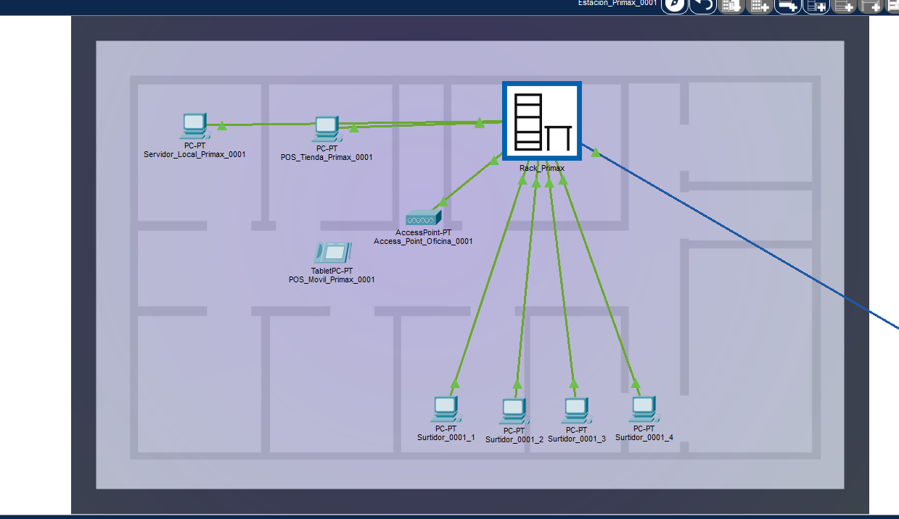

# Red WAN/LAN: ISP Lima y Estaciones Primax

Simulación en **Cisco Packet Tracer** de una red ISP metropolitana con redundancia en anillo para interconectar estaciones de servicio Primax, oficinas centrales, hogares y cobertura móvil.

## Lo Implementado

* **Núcleo ISP:** 4 routers Core en anillo cerrado enlazados a una nube **Frame Relay**.
* **Anillo Metropolitano:** 8 routers distritales (Chorrillos, Barranco, Miraflores, San Isidro, Jesús María, Cercado de Lima, San Borja y Surco) conectados en anillo perimetral con enlaces de respaldo cruzados.
* **Enrutamiento:** **OSPF Área 0** en el backbone ISP con redistribución de rutas estáticas hacia las sedes cliente.
* **Estaciones Primax (Chorrillos y Miraflores):** Red administrativa conectada al ISP (servidor local, POS fijo, POS móvil Wi-Fi y controlador) y red de pista aislada para surtidores.
* **Data Center Primax HQ (Surco):** Servidor global conectado al anillo en Surco.
* **Cobertura Móvil 4G/5G (Chorrillos):** Torre celular operativa conectando dispositivos móviles al ISP.
* **Clientes Residenciales:** Redes LAN con **DHCP** y Wi-Fi en Chorrillos, Miraflores y Surco.

## Vistas de la Topología

### Topología Lógica Global

### Mapa Físico Lima Metropolitana

### Centro ISP y Rack Principal (Cercado de Lima)

### Despliegue Físico en Distrito (Chorrillos)

### Estación de Servicio Primax (Lógica y Física)

## Pruebas Realizadas

* **Asignación DHCP:** Obtención automática de direcciones en PCs/laptops residenciales y smartphones 4G/5G.
* **Conectividad Extremo a Extremo:** Comunicación exitosa mediante `ping` entre estaciones Primax, dispositivos móviles y el Data Center central.
* **Segmentación de Seguridad:** Aislamiento verificado de los surtidores de pista frente a accesos externos.
* **Redundancia y Convergencia:** Reconexión automática del tráfico OSPF tras simular cortes de enlaces y caída de routers Core.