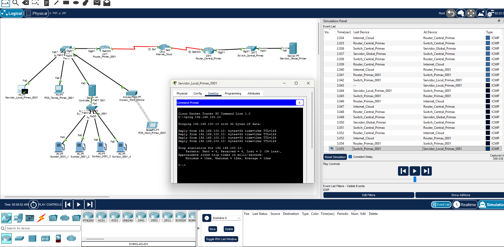

# Proyecto Cisco Redes

## Introducción

Este proyecto académico presenta una simulación de una topología de red para una sucursal de una empresa de estaciones de servicio en Perú, tomando como referencia teórica a Primax. La propuesta es desarrollada en Cisco Packet Tracer y representa la conexión entre los equipos y servicios de la sucursal con la red central (bajo limitaciones de diversidad de dispositivos en el entorno). Además, permite observar el funcionamiento de la comunicación entre los dispositivos mediante pruebas realizadas en el entorno simulado.

## Topología de red

